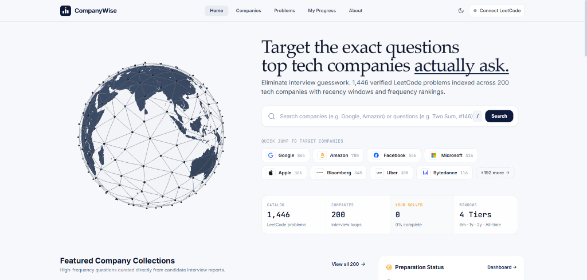

# CompanyWise — Technical Interview Preparation & Company Datasets

> **CompanyWise** is an interactive, engineering-grade interview intelligence platform with one-click public LeetCode profile synchronization, coupled with the complete archive of company-specific problem frequency datasets.

[](https://companywise-arh.vercel.app)
[](https://react.dev/)
[](https://www.typescriptlang.org/)
[](https://vitejs.dev/)
[](https://tailwindcss.com/)
[](LICENSE)

🔗 **Live Platform**: [https://companywise-arh.vercel.app](https://companywise-arh.vercel.app)



---

## 📑 Table of Contents

- [Overview & The Problem](#-overview--the-problem)
- [Key Features](#-key-features)
  - [490 Tech Companies & 3,411 Questions](#1-490-tech-companies--3411-canonical-problems)
  - [6 Recency Time Windows](#2-6-recency-time-windows)
  - [Target Company Tracking & Goals](#3-target-company-tracking--preparation-goals)
  - [LeetCode Profile Sync](#4-leetcode-profile-sync--zero-password-privacy)
  - [Custom Themed UI & Searchable Dropdowns](#5-custom-themed-ui--searchable-dropdowns)
  - [Practice Velocity & Streaks](#6-practice-velocity--streak-tracker)
  - [Native WebGL 3D Visualization](#7-native-webgl-3d-visualization)
- [The Story Behind CompanyWise (About Section)](#-the-story-behind-companywise)
  - [Chapter 01 — The Purpose: A Smarter Way to Prepare](#chapter-01--the-purpose-a-smarter-way-to-prepare)
  - [Chapter 02 — The Foundation: Curator Krishna Dey](#chapter-02--the-foundation-curator-krishna-dey)
  - [Chapter 03 — The Expansion: Contributor liquidslr](#chapter-03--the-expansion-contributor-liquidslr)
  - [Chapter 04 — The Creation: Builder Alokam Ruchith](#chapter-04--the-creation-builder-alokam-ruchith)
  - [Engineering & Architecture Decisions](#engineering--architecture-decisions)
- [Dataset Ingestion & Audit Summary](#-dataset-ingestion--audit-summary)
- [Technology Stack](#-technology-stack)
- [Repository Structure](#-repository-structure)
- [Getting Started & Local Development](#-getting-started--local-development)
- [Deployment](#-deploying-to-vercel)
- [Disclaimer & License](#-disclaimer--license)

---

## 💡 Overview & The Problem

Interview preparation often turns into solving hundreds of random algorithmic questions on LeetCode without knowing whether target employers actually test those patterns. 

While raw collections of CSV files with company-specific questions have existed on GitHub, navigating hundreds of flat spreadsheet files while coding is cumbersome, disjointed, and lacks real-time progress tracking.

**CompanyWise** solves this by unifying **1,112 curated company-wise CSV files** into an ultra-fast, zero-telemetry, client-side web application. It bridges the gap between historical candidate interview reports and active coding preparation, offering relative frequency indices, recency filtering, one-click LeetCode profile synchronization, and goal tracking.

---

## ✨ Key Features

### 1. 490 Tech Companies & 3,411 Canonical Problems
- Full coverage of **490 global technology companies**, including Big Tech (FAANG / MAMAA), high-growth product companies, venture-backed startups, quantitative finance firms, and enterprise service leaders.
- Deduplicated catalog of **3,411 unique LeetCode problems** with indexed direct problem URLs, acceptance percentages, difficulty classifications (Easy, Medium, Hard), and cross-company frequency indices.

### 2. 6 Recency Time Windows
Interview patterns evolve over time. CompanyWise provides dynamic time-period filtering so candidates can see long-term classics or urgent recent trends:
- **Last 30 Days**: Freshly reported questions from the latest interview rounds.
- **Last 3 Months**: Trending questions tested in the current hiring quarter.
- **Last 6 Months**: High-signal problems for immediate interview prep.
- **Last 1 Year**: Core foundational questions frequently encountered over the past year.
- **Last 2 Years**: Multi-year recurring algorithmic patterns.
- **All Time**: The complete historical interview question benchmark.

### 3. Target Company Tracking & Preparation Goals
- **1-Click Target Toggling**: Mark your dream companies as targets directly from the Company Detail page or directly from the Companies catalog table via the star toggle.
- **Persistent Storage**: Target company selections are saved locally to `localStorage` and persist across sessions.
- **Targeted Filter Tabs**: Filter both the **Companies Catalog** and the **Progress Matrix** to view only your chosen target companies.
- **Dynamic Home Dashboard**: Your targeted companies are automatically prioritized and featured on the Home Dashboard shortcuts.

### 4. LeetCode Profile Sync & Zero-Password Privacy
- **Client-Side Sync**: Connect your public LeetCode handle directly from the top navigation bar without entering any password.
- **Public Submission Import**: Fetches your recently accepted LeetCode submissions (up to 100 via public GraphQL proxy with public API fallback) and automatically marks matching problems as completed across all 490 companies. Older solved problems can be marked manually or restored via backup.
- **Global Cross-Company Propagation**: When a problem is marked as solved, it updates instantly across every company where that question appears, updating overall completion percentages and difficulty distributions.
- **Export & Import**: Full data portability with 1-click JSON backup export and restore.

### 5. Custom Themed UI & Searchable Dropdowns
- **Design System Native**: Completely replaces unstyled OS-native select controls with custom animated dropdowns that respect both light (`#F7F8FB`) and dark (`#262624` / `#30302E`) themes.
- **Instant Search Across 490 Companies**: The company filter on the Problems page includes a built-in search input with question count badges, making finding any employer effortless.
- **Apple–Google–Meta Animated Hero Illustration**: Clean, responsive, geometric SVG illustration integrated directly into the Companies header without layout shifts or extraneous containers.

### 6. Practice Velocity & Streak Tracker
- **7-Day Activity Velocity**: Dynamic chart displaying daily problems solved over the past week based on real user interactions.
- **Active Streak Counter**: Visual fire streak tracker motivating consistent daily algorithmic practice.
- **Per-Difficulty Gauges**: Real-time progress bars showing completion splits across Easy, Medium, and Hard problems.

### 7. Native WebGL 3D Visualization
- **Zero Heavy 3D Libraries**: Custom WebGL 1 shader implementation rendering a geodesic network globe with 738 network edges and 248 metallic nodes.
- **Theme-Aware Shading**: Globe continents and points dynamically invert and adapt between dark and light modes with zero performance degradation.

---

## 📖 The Story Behind CompanyWise

### CHAPTER 01 — THE PURPOSE: A Smarter Way to Prepare
Interview preparation shouldn't mean solving hundreds of random problems and hoping for the best. CompanyWise was built around a simple idea: **know what to practice, understand why it matters, and track how far you've come.**

Instead of navigating scattered spreadsheets, candidates can explore company-specific questions, identify frequently reported problems, and focus preparation using historical interview trends.

---

### CHAPTER 02 — THE FOUNDATION: Curator Krishna Dey
Great projects often begin with someone else's generous contribution to open source. The foundation of CompanyWise comes from the dedicated work of **Krishna Dey ([@krishnadey30](https://github.com/krishnadey30))**, who collected, organized, and openly shared company-wise LeetCode question data drawn from candidate interview reports.

His repository, [krishnadey30/LeetCode-Questions-CompanyWise](https://github.com/krishnadey30/LeetCode-Questions-CompanyWise), contained an initial collection of **537 CSV files** representing **20,453 question occurrences**. That archive became the foundational bedrock upon which CompanyWise was architected. Full credit for curating and sharing that original dataset belongs to Krishna.

---

### CHAPTER 03 — THE EXPANSION: Contributor liquidslr
Technical interview patterns continuously shift. Keeping problem frequency rankings current and reflecting recent hiring trends is essential.

To expand and refresh the catalog, CompanyWise integrated the comprehensive dataset maintained by **liquidslr ([@liquidslr](https://github.com/liquidslr))** from their repository [liquidslr/leetcode-company-wise-problems](https://github.com/liquidslr/leetcode-company-wise-problems).

Their contribution introduced:
- **290 newly covered companies**
- **1,965 newly indexed problems**
- Essential high-signal recency windows: **Last 30 Days** and **Last 3 Months**

This expansion broadened CompanyWise into a complete archive of **490 companies** and **3,411 canonical LeetCode questions**. We recognize and thank liquidslr for their dedication to openly sharing and regularly updating this valuable collection.

---

### CHAPTER 04 — THE CREATION: Builder Alokam Ruchith
**Alokam Ruchith ([@aruchith08](https://github.com/aruchith08))**, an engineering student at BVRIT, conceived, designed, and developed CompanyWise.

While preparing for technical interviews, Ruchith relied on open-source CSV collections. Although the information was invaluable, navigating hundreds of disparate spreadsheets while actively solving problems was inefficient. This sparked the vision: *what if all this valuable data could become one unified, interactive, beautifully designed platform?*

What began as a tool for personal preparation evolved into a full-scale web application for the global developer community:
- Designed and built the offline TypeScript ingestion and deduplication pipeline (`website/scripts/build-data.ts`).
- Developed the complete React 18 + Vite + Tailwind application and custom UI component system.
- Created the zero-telemetry LeetCode profile synchronization architecture.
- Engineered the native WebGL 3D network globe and responsive interface.

🔗 **Connect with Alokam Ruchith**:
- **GitHub**: [@aruchith08](https://github.com/aruchith08)
- **LinkedIn**: [in/ruchithalokam](https://linkedin.com/in/ruchithalokam)
- **X (Twitter)**: [@A_Ruchith](https://x.com/A_Ruchith)
- **Website**: [alokam.com](https://alokam.com)

---

### Engineering & Architecture Decisions

| Principle | Implementation |
|---|---|
| **Offline-First Ingest Pipeline** | All 1,112 CSV files are parsed, validated, and normalized offline by a TypeScript script (`website/scripts/build-data.ts`). It generates unified, compressed static JSON artifacts (`index.json`, `questions.json`, individual company files) served directly via Vite. |
| **Zero-Tracking Privacy Design** | No analytics trackers, third-party tracking scripts, or intermediate database servers. Your solved questions, bookmarks, notes, target companies, and LeetCode profile reside strictly inside your browser's `localStorage`. |
| **Native WebGL 3D Visualization** | Avoids heavy runtime libraries (e.g., Three.js) in favor of raw WebGL 1 shaders with 738 geodesic network edges and 248 metallic nodes. Continents procedurally adapt to dark mode with real-time DOM mutation observation. |
| **Restrained System Typography** | Zero web font downloads. Powered by local device font stacks: editorial serif (`Iowan Old Style`, `Georgia`, `Charter`) for headings, and high-legibility system sans (`San Francisco`, `Segoe UI`, `system-ui`) for user interface controls. |

---

## 📊 Dataset Ingestion & Audit Summary

The platform operates on an offline data pipeline (`website/scripts/build-data.ts`) that parses, normalizes, validates, and deduplicates all 1,112 CSV files in `csv-data/`.

| Metric | Value |
|---|---|
| **Total CSV Files in `csv-data/`** | **1,112 / 1,112 (100%)** |
| **Total Records Parsed** | **38,825** |
| **Valid Records** | **38,825** |
| **Invalid Records** | **0** |
| **Duplicate Records Within Files** | **0** |
| **Unique Companies Represented** | **490** |
| **Unique Canonical LeetCode Questions** | **3,411** |
| **Supported Time-Period Filters** | **30 Days, 3 Months, 6 Months, 1 Year, 2 Years, All Time** |
| **Questions with Valid Direct Links** | **3,411 (100%)** |

---

## 🛠️ Technology Stack

- **Frontend Framework**: [React 18](https://react.dev/) with [TypeScript 5](https://www.typescriptlang.org/)
- **Bundler & Dev Server**: [Vite 6](https://vitejs.dev/) with `@vitejs/plugin-react`
- **Styling & Design System**: [Tailwind CSS 3.4](https://tailwindcss.com/), PostCSS, Autoprefixer
- **Client-Side Routing**: [React Router DOM 6](https://reactrouter.com/)
- **Icons**: [Lucide React](https://lucide.dev/) & High-Resolution Vector Brand SVGs
- **Data Ingestion**: [Papa Parse](https://www.papaparse.com/) for CSV parsing and validation
- **Testing**: [Vitest](https://vitest.dev/) with JSDOM
- **State & Storage**: React Context, Custom Hooks, Browser `localStorage`
- **Deployment**: [Vercel](https://vercel.com/) with Edge Serverless Functions

---

## 📁 Repository Structure

```
LeetCode-Questions-CompanyWise/
├── website/                   # Full React 18 + Vite 6 + Tailwind web application
│   ├── api/                   # Serverless functions (LeetCode GraphQL proxy)
│   ├── public/                # Static assets, company logos, and generated JSON datasets
│   │   ├── data/              # Ingested datasets (index.json, questions.json, report.json, companies/)
│   │   ├── logos/             # High-res company logos in SVG & PNG (transparent)
│   │   ├── alokam-ruchith.png # Creator profile photo
│   │   ├── krishnadey.png     # Curator profile photo
│   │   └── liquidslr.png      # Contributor profile photo
│   ├── scripts/               # Offline CSV ingestion and normalization pipeline
│   │   └── build-data.ts      # Automated validator, normalizer, and JSON builder
│   ├── src/                   # React application source code
│   │   ├── components/        # Reusable UI components (CustomDropdown, Globe, Navbar, etc.)
│   │   ├── hooks/             # Custom hooks (useProgress, useAllQuestions, useCompanyData, etc.)
│   │   ├── pages/             # Page views (HomePage, CompaniesPage, ProblemsPage, ProgressPage, AboutPage)
│   │   ├── types/             # TypeScript definitions
│   │   └── services/          # LeetCode API sync service
│   ├── tests/                 # Vitest automated test suite
│   ├── package.json           # Website dependencies and scripts
│   ├── vite.config.ts         # Vite bundler configuration
│   └── vercel.json            # Vercel deployment configuration
│
├── csv-data/                  # Complete archive of 1,112 company-wise CSV files
│   ├── google_1year.csv
│   ├── amazon_6months.csv
│   ├── meta_alltime.csv
│   └── ... (1,112 datasets across 490 companies & 6 time intervals)
│
├── others/                    # Design specifications, documentation, and tooling
│   ├── DESIGN.md              # Design system and typography specifications
│   ├── PRODUCT.md             # Product requirements and feature roadmap
│   └── .impeccable/           # Design review checkpoints
│
├── .gitignore
├── package.json               # Root monorepo forwarder scripts
├── vercel.json                # Root Vercel deployment configuration
└── README.md
```

---

## 📦 Getting Started & Local Development

You can run commands from the repository root or directly within the `website/` directory.

### Prerequisites
- [Node.js](https://nodejs.org/) (version 18.0.0 or higher)
- `npm` (version 9.0.0 or higher)

### 1. Clone the Repository
```bash
git clone https://github.com/aruchith08/LeetCode-Questions-CompanyWise.git
cd LeetCode-Questions-CompanyWise
```

### 2. Install Dependencies
```bash
npm install --prefix website
```

### 3. Build & Validate Datasets (Optional if already built)
To run the automated CSV ingestion pipeline over all 1,112 CSV files:
```bash
npm run data:build
```

### 4. Start Development Server
```bash
npm run dev
```
Open your browser at `http://localhost:5173`.

### 5. Run Automated Tests
```bash
npm test
```

### 6. Build for Production
```bash
npm run build
```

---

## 🚀 Deploying to Vercel

The project is pre-configured with root and subdirectory `vercel.json` configurations for instant deployment:

### Option 1: Vercel Dashboard (Recommended)
1. Go to [Vercel Dashboard](https://vercel.com/new).
2. Import this repository: `https://github.com/aruchith08/LeetCode-Questions-CompanyWise`.
3. Vercel automatically detects the configuration and deploys.
   - If setting Root Directory to `website`: it deploys using `website/vercel.json`.
   - If leaving Root Directory as `./` (default): it deploys using root `vercel.json`.
4. Click **Deploy**.

### Option 2: Vercel CLI
```bash
cd website
npx vercel
```

---

## ⚖️ Disclaimer & License

- **Disclaimer**: CompanyWise is an independent open-source project and is not affiliated, associated, authorized, endorsed by, or in any way officially connected with LeetCode Inc. LeetCode is a registered trademark of LeetCode Inc. All company names, logos, and brands are property of their respective owners.
- **Dataset Provenance & Snapshot**: Static data snapshot as of October 2026. The catalog unifies public company-tagged interview question datasets compiled from candidate reports (original curation by Krishna Dey [@krishnadey30](https://github.com/krishnadey30), expanded by liquidslr [@liquidslr](https://github.com/liquidslr)).
- **Frequency Index Definition**: The reported frequency metric is an empirical appearance index derived from the source CSV snapshot entries, not a guaranteed probability or prediction of receiving any specific question in an interview.
- **License**: Released under the [MIT License](LICENSE).
